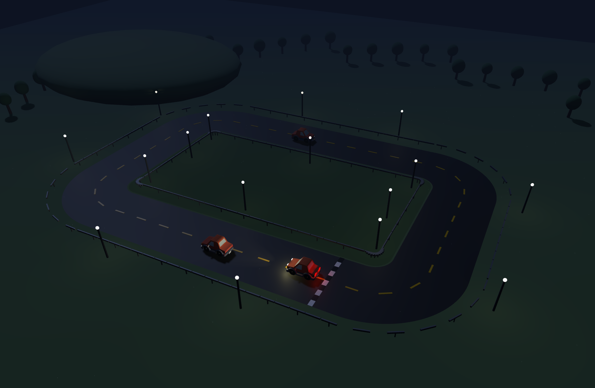

<div align="center">

# 🏁 RaceTrack

**Ein Three.js-Rennspiel ohne Build-Schritt — HTML öffnen, fahren.**

[](https://threejs.org/)
[](#schnellstart)
[](LICENSE)



</div>

## Features

- **Drei Szenarien:** *Stadtkurs* (Straßenkurs durch eine prozedural aufgebaute Kleinstadt), *Landstrecke* (offene Piste mit Wald und Hügeln) und ***Freie Fahrt*** — die ganze Stadt ohne Strecke, mit Gebäudekollision und Kilometerzähler
- **14 fahrbare Autos** aus dem Kenney Car Kit, auswählbar über einen Startbildschirm mit den Original-Vorschaubildern
- **Fahrphysik** mit Ackermann-Lenkung, Schräglauf/Drift, Gripgrenze, Radlastverlagerung und Federung
- **3 KI-Gegner** mit eigenen Modellen, Fahrspuren und Auffahr-Erkennung
- **Rundenzeiten** inkl. Sektoren-Checkpoints, Abkürzungs-Erkennung, Bestzeiten-Speicher und **Ghost** der schnellsten Runde
- **Hindernisse** (Pylonen, Kisten, Debris) die beim Treffer wegfliegen und Tempo kosten
- **Leitplanken-Kollision**, Tag-/Nacht-Umschaltung, Minimap, Live-Tuning-Panel, prozeduraler Motorsound
- **Keine Abhängigkeiten, kein Bundler** — three.js kommt über eine Import-Map vom CDN

## Schnellstart

```shell
# Beliebiger statischer Server, z. B.
python3 -m http.server 8000
# oder
npx serve -l 8000
```

Dann **http://localhost:8000** öffnen. `file://` funktioniert nicht — ES-Module und
`fetch()` auf die GLB-Dateien brauchen HTTP.

## Freie Fahrt

Kein Rundkurs, keine Zeitnahme: die Stadt füllt ein Raster von 224 × 224 Metern, du
startest an einer Kreuzung und fährst, wohin du willst. Das HUD wird dabei zum
Bordcomputer — gefahrene Strecke, Fahrzeit, Höchstgeschwindigkeit statt Runden.

Drei Dinge unterscheiden den Modus technisch vom Rundkurs:

- **Die Häuser halten dich auf.** Ohne Strecke gibt es keinen Leitplanken-Korridor, der
  das Auto führt. `createCityCollider` in [`src/scene/city.js`](src/scene/city.js) legt
  die Gebäudegrundrisse in Buckets auf dasselbe Raster, prüft nur die neun Zellen um
  das Auto und schiebt es über die flachere der beiden Überlappungsachsen heraus —
  also über die Wand, die man tatsächlich getroffen hat.
- **Der Schattenwurf wandert mit.** Die Shadow-Map deckt rund 90 m ab, die Stadt 224 m.
  Statt die Map aufzublähen (und ihre Auflösung zu verlieren), folgt die Sonne samt
  Schattenbox dem Auto.
- **Die Gegner werden zu Stadtverkehr.** Sie fahren einen geschlossenen Ring durch das
  Straßenraster, der als ganz normaler `trackPath` erzeugt wird — damit funktionieren
  Pure-Pursuit-Fahrer, Minimap und Auffahr-Erkennung unverändert weiter.

Die Minimap zeigt hier das Straßennetz statt einer Ideallinie. `Backspace` setzt dich
auf die nächstgelegene Straße zurück, falls du dich festfährst.

## Der Stadtkurs

Die Stadt wird beim Start aus 1×1-Kacheln des Kenney City-Builder-Kits generiert, nicht
von Hand platziert. Für jede Zelle des 8-Meter-Rasters fragt
[`src/scene/city.js`](src/scene/city.js) die Mittellinie der Strecke nach dem Abstand und
entscheidet daraus:

| Abstand zur Mittellinie | Ergebnis |
| --- | --- |
| < 10,5 m | frei (Fahrbahn + Leitplanke) |
| < 15 m | Gehweg |
| innerhalb des Ovals | Park, mit Brunnen in der Mitte |
| sonst | Stadtblock: Straße, Gebäude oder Grünfläche |

Das Straßennetz kachelt sich selbst: jede Straßenzelle prüft ihre vier Nachbarn und wählt
Gerade, Kurve, T-Stück oder Kreuzung mit der passenden Drehung — so schließt das Raster
sauber ab, wo es auf den Kurs trifft. Die Platzierung ist über einen Hash deterministisch,
die Stadt sieht also bei jedem Laden gleich aus.

Derselbe Generator baut auch die Freie Fahrt; dort entfällt nur die Streckenabfrage.

Zwei Zahlen, die nicht offensichtlich sind: die Abstände rechnen mit der **halben Diagonale**
der Kachel (5,66 m bei 8 m Kantenlänge), nicht mit der halben Kantenlänge — sonst ragen
Ecken auf die Fahrbahn. Und die Kacheln des Kits sind Sockelplatten: eine Straße liegt
0,05 Einheiten hoch, ein Gehweg 0,06 — bei 8 m Kantenlänge also 40 bzw. 48 cm. Die ganze
Stadt wird deshalb um die Straßenhöhe abgesenkt (`CITY_Y`), damit Fahrbahnen auf `y = 0`
liegen und befahrbar sind; die Gehwege stehen dann 8 cm vor und lesen sich als Bordstein.

Die ganze Stadt kostet **14 zusätzliche Draw Calls** (eine InstancedMesh pro Modelltyp).

## Steuerung

| Taste | Funktion |
| --- | --- |
| `W` `A` `S` `D` / Pfeiltasten | Gas, Lenken, Bremsen / Rückwärts |
| `Leertaste` | Handbremse (löst das Heck aus) |
| `C` | Kamera: Verfolgung → Haube → Orbit |
| `P` | Autopilot |
| `O` | KI-Gegner ein/aus |
| `G` | Ghost der besten Runde |
| `M` / `R` | Minimap / Ideallinie |
| `L` / `N` | Fahrzeuglicht / Tag–Nacht |
| `T` / `V` | Tuning-Panel / Waypoint-Debug |
| `F` / `H` | Performance-Anzeige / Hilfe |
| `Backspace` | Auto zurück auf Strecke / Straße setzen |

## Auf GitHub Pages veröffentlichen

Das Spiel ist rein statisch und läuft unverändert auf Pages.

1. Repository → **Settings → Pages → Source: GitHub Actions**
2. Push auf `main` — [`.github/workflows/deploy-pages.yml`](.github/workflows/deploy-pages.yml)
   erledigt den Rest.

Der Workflow kopiert bewusst nur die Laufzeit-Dateien in das Artefakt (GLB-Modelle,
Previews, `src/`, HTML/CSS). Die FBX- und OBJ-Varianten des Car Kits sowie `assets/car.glb`
bleiben im Repository, werden aber nicht veröffentlicht: **~7 MB statt ~29 MB**.

Zwei Dinge, die bei Pages sonst stolpern:

- `.nojekyll` liegt im Repo-Root, sonst filtert Jekyll Pfade heraus.
- Der Asset-Pfad enthält ein Leerzeichen (`Models/GLB format/`). Das funktioniert
  URL-kodiert, ist aber beim Umbauen leicht kaputtzumachen — `npm run check`
  (bzw. der Workflow-Schritt) prüft, dass jedes im Katalog referenzierte Modell
  wirklich ausgeliefert wird.

## Projektstruktur

```
src/
├── main.js                     Bootstrap + Spielschleife
├── input.js                    Tastatur inkl. Flankenerkennung, Fokus-Reset
├── Vehicle.js                  Fahrzeug: Physik, Modell-Räder, Lampen, Abgas
├── config/
│   ├── vehicleConfig.js        Basiswerte + Merge-Logik
│   ├── carCatalog.js           Fahrzeuge, Gegner und Streckenprops
│   └── cityCatalog.js          Stadtmodelle und Rasterparameter
├── core/
│   ├── assetLoader.js          GLB-Cache, geteiltes Material/Textur
│   ├── instancing.js           InstancedMesh-Helfer
│   ├── trackPath.js            Allokationsfreie Streckengeometrie-Abfragen
│   ├── pathDriver.js           Pure-Pursuit-Fahrer (Autopilot + KI)
│   ├── collisionSystem.js      Props + Leitplanken-Korridor
│   ├── lapController.js        Rundenzeiten, Checkpoints, Ghost-Sampling
│   └── …                       Kamera, Loop, Renderer, Sound, Tuning, Minimap
├── scene/
│   ├── createScene.js          Baut die Welt zusammen, je Szenario
│   ├── city.js                 Stadtraster, Straßen-Autotiling, Gebäudekollision
│   ├── track.js                Fahrbahn, Curbs, Leitplanken (instanziert)
│   ├── materials.js            Geteilte Materialien
│   └── …                       Terrain, Licht, Props, Wetter
└── ui/
    ├── hud.js                  HUD, Toasts, Performance-Overlay
    └── startOverlay.js         Fahrzeugauswahl + Ladebildschirm
```

## Anpassen

**Auto hinzufügen** — in [`src/config/carCatalog.js`](src/config/carCatalog.js) einen
Eintrag ergänzen; die `id` ist der Dateiname im Kit (ohne `.glb`), das Vorschaubild
wird automatisch aus `Previews/<id>.png` geladen:

```js
{ id: 'garbage-truck', name: 'Müllwagen', klass: 'Nutzfahrzeug', bodyLength: 5.4,
  dynamics: { maxSpeed: 12, accelRate: 6.5, gripLimit: 8 } }
```

**Fahrverhalten** — zur Laufzeit mit `T` justieren und als Preset speichern, oder die
Startwerte in [`src/config/vehicleConfig.js`](src/config/vehicleConfig.js) ändern.

**Strecke** — die Maße stehen in `TRACK` in [`src/scene/track.js`](src/scene/track.js).

**Stadt** — Blockgröße, Straßenabstand, Grünanteil und Ausdehnung stehen in `CITY_LAYOUT`
(Stadtkurs) bzw. `FREEROAM_LAYOUT` (Freie Fahrt) in
[`src/config/cityCatalog.js`](src/config/cityCatalog.js).

## Koordinatensystem

Vorwärts ist `+Z`, oben `+Y`, und damit liegt die **linke** Fahrzeugseite auf `+X`
(`rechts = vorwärts × oben`). Ein positiver Lenkwinkel bedeutet Linkskurve, positives
`heading` dreht nach links. Die Kenney-Modelle folgen derselben Konvention
(`wheel-front-left` liegt bei `+X`), weshalb ihre Räder direkt übernommen werden können.

## Technik

- [Three.js r165](https://threejs.org/) über CDN-Import-Map (`three`, `three/addons/`)
- Vanilla ES-Module, kein Bundler, keine `node_modules`

### Assets

| Paket | Verwendung | Quelle | Lizenz |
| --- | --- | --- | --- |
| Kenney **Car Kit** | Fahrzeuge, Pylonen, Debris | [kenney.nl](https://kenney.nl/assets/car-kit) | CC0 |
| Kenney **Starter Kit: City Builder** | Gebäude, Straßen, Gehwege, Parks | [github.com/KenneyNL](https://github.com/KenneyNL/Starter-Kit-City-Builder) | CC0 (Repo-Code MIT) |

Details in `assets/kenney_car-kit/License.txt` und `assets/kenney_city-kit/CREDITS.txt`.

Beide Kits texturieren ihre Modelle mit einer Datei namens `colormap.png` — es sind aber
**zwei verschiedene Paletten**. [`src/core/assetLoader.js`](src/core/assetLoader.js) teilt
Material und Textur deshalb pro Kit (abgeleitet aus dem Verzeichnis), nicht global.

---

<div align="center"><b>Gute Fahrt 🏎️</b></div>
